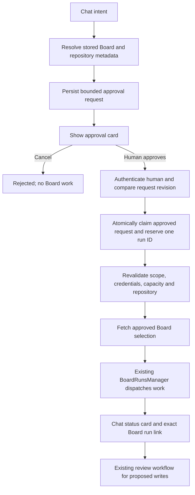

# Hypervisor chat to Board runs: implementation plan

Status: plan only. No application implementation in this change.

Target: the user's local KubeCoder workspace, with RAM efficiency prioritized.
Evidence: current checkout inspected on 2026-10-27; selected existing tests run
as recorded below. Proposed behavior is distinguished from existing behavior.

## 1. What Imran is asking for

An ordinary Hypervisor/CTO conversation should understand a request such as
"run the board for owner/repository", hand the work to the existing Board
orchestrator, and let the user follow that specific run from Chat into Board.

The additional product requirements are mandatory:

- Ask the user before executing Board work. The initial chat instruction is
  a request to prepare the action, not the final permission to execute it.
- Show exactly what will run, and show an honest outcome and next action.
- Keep the design minimal, structured, debuggable, and free of unnecessary
  runtime packages or services.
- Handle failures in the backend and UI, including timeouts and uncertain
  outcomes. Complete both deterministic end-to-end tests and live tests with a
  real agent and a real test board before declaring the feature verified.

## 2. What already works, verified in source

| Existing capability | Evidence | Consequence for this feature |
| --- | --- | --- |
| Board REST API, including create/list/get/stop runs | `charts/workspace/handlers/boards.py`, `handle_board_run_create`, `handle_board_run_stop`, `ROUTES` | Extend this API; do not build a second Board API or scheduler. |
| Run orchestration, concurrency limits, item dispatch, leases, processed markers, restart reconciliation | `charts/workspace/server.py`, `BoardRunsManager`; `charts/workspace/boards/runs.py` | Reuse this implementation and its safety checks. |
| Repository placement and isolated worktrees | `BoardRunsManager.create`, `boards/runs.py::validate_repo_config`, `WorktreeManager.check_run_workdir` | Reuse repository validation and isolation. |
| Propose mode and review before tracker writes | `handlers/boards.py::handle_board_action`, `BoardReviewManager`, `boards/review.py` | Preserve a separate human decision for external writes. Starting a run is not approval of its eventual replies or ticket changes. |
| Agent tools to list boards, read an item, probe connectors, take an item action, and report a disposition | `charts/workspace/mcp_dashboard.py::TOOLS` | There is no dedicated request/start/stop/status Board-run tool in this registry. |
| Board item to Chat navigation | `web/src/routes/board/itemChat.ts` | This is the reverse direction, for one item, not the requested chat-to-run handoff. |
| Board run display, SSE and polling | `web/src/routes/board/RunsPanel.tsx`, `web/src/store/boards.ts`, `web/src/api/events.ts` | Reuse the run display and event transport. |
| Review-item deep links | `web/src/routes/board/index.tsx` reads `board` and `review` query parameters | Add explicit run navigation; a generic Board link is insufficient. |
| Persistent cross-turn watchers | `hypervisor_session.py::WatcherManager` | Current kinds are task, command, file, port. Add a single Board-run kind if conversational completion updates are required; do not create another scheduler. |
| Local testing stack | `web/package.json`, `tests/boards_e2e_test.py`, `.github/workflows/ci.yml` | Preact, signals, Python unittest, Vitest and Playwright already exist. No new package is needed. |

Answer to "does that already work?": the underlying run API and orchestration
exist. The complete permission-gated conversational handoff and its inline UX
do not. A general-purpose agent could attempt to call the HTTP API from its
shell; that is not evidence that the intended product flow is implemented.

## 3. Permission contract and the authentication prerequisite

Treat "before doing anything on Board" conservatively for this workflow:

1. Before approval, only inspect already-stored workspace metadata to resolve
   the candidate Board/repository and prepare an approval request. Creating
   that request must not fetch vendor items, probe a connector, create a run,
   reserve item leases, create worktrees, launch workers, or change tickets.
2. The approval card explicitly grants the bounded external read and run:
   "Read matching items and start up to N workers/items for this repository."
   Counts before the read are limits, not invented exact item counts.
3. Approval authorizes only that snapshot of the board, repository, filters,
   item limit, concurrency ceiling, isolation/base revision and mode.
   Changing any of these invalidates the approval and asks again.
4. Proposed initial release: chat-started runs use **Propose** mode. Workers
   may read the approved board and work in the approved isolated checkout;
   their tracker changes remain staged for human review. The card explicitly
   discloses local code/commit work and use of the configured coding agent.
5. Stop, rerun, expanded scope, connector changes, and external review
   decisions require their own explicit user action. No silent retry starts
   another run. A run does not gain permission to push or merge code merely
   because the user approved running it.
6. A typed "yes", agent prose, a tool argument, or a checkbox preselected by
   the agent is not the authoritative approval. The approved UI action is.

**Verified authentication gap:** `mcp_dashboard.py` reads the same workspace
bearer token accepted by `server.py::check_claude_auth`. Its existing
`_needs_confirm` checks a caller-supplied boolean. In Basic mode,
`check_claude_auth` returns true because it trusts the ingress; it does not
establish a human identity for an in-pod caller. `check_oauth_only` alone is
also not a universal solution for local Basic/token deployments.

The checked-in local values use Basic authentication, but the user's actual
running configuration has not been verified. Furthermore,
`web/dev_server.py` deliberately bypasses both auth checks. It must not be
used as proof of approval security.

Implementation phase 0 must establish a real distinction between human
approval and agent requests:

- Add one small approval-auth boundary, using the existing deployment's
  verified user session where possible. Reject the workspace agent bearer
  token on approval decisions, including direct HTTP calls.
- For local Basic authentication, verify a browser approval session against
  the actual Basic-auth deployment rather than trusting a request header or
  `Origin`. If necessary, use a separate human approval credential/session
  unavailable to the agent. Do not mint it using the shared workspace token.
- Verify proxy/session provenance and CSRF protection. Arbitrary forwarded
  headers, localhost access and a missing `thread_id` must not bypass approval.
- Audit the existing run-start, item-action and review-decision routes as
  alternative paths. Agent execution must carry the approved, narrowly scoped
  run authorization; agent callers cannot use manual routes to self-approve.
  Existing Board UI actions migrate to the same trusted human boundary.
- Check process/filesystem access in the local runtime. A secret or approval
  JSON on storage readable/writable by the agent is not an isolation boundary.
  If backend and unrestricted agents share that privilege, isolate approval
  authority/credentials before claiming protection against agent bypass.
- Unsupported configurations fail closed with "User approval is not configured
  for this workspace" and a setup action. They must not fall back to
  `confirm=true` or a development auth bypass.

The exact Basic/session wiring is a prerequisite to finalize against the local
deployment, not an invented claim about a capability already present. This
does not require a new identity provider, Redis, or a job service. Protection
against a fully compromised host is outside this feature's guarantee.

## 4. Intended UX

Keep the interaction in the chat, with one compact card that changes state.
Use existing typography, spacing, buttons, status colors and light/dark theme
tokens. Details expand on demand; no new dashboard or permanent modal.

```text
User: Run the board for acme/api

Board run - approval needed
Board: API backlog                 Repository: acme/api
Scope: up to 3 matching items      Workers: 1 at a time
Mode: Propose                     Code: isolated worktree
Reads the board and works locally. Tracker changes need review.

[Approve & run]   [Adjust]   [Cancel]

After approval:
Starting Board run...              Checking access and matching items

After the server records the run:
Passed to Board                    acme/api
1 working / 2 waiting              Last checked just now
[Open Board]   [View details]

When work settles:
Work finished - 2 need your review
[Review results]   [Open Board]
```

The numbers above illustrate the proposed local test profile, not a fact about
the user's connected board. Production limits must be visible and editable.

- If repository/board matching is ambiguous, present a short picker and require
  selection. Never run the first matching display name.
- If no board is connected, show "No connected board for this repository" with
  **Choose board** / **Connect board**. Do not silently generate a connector.
- **Adjust** edits the small set of relevant fields and returns to the approval
  state. **Cancel** records rejection and dispatches nothing.
- Keep the user in Chat after approval. **Open Board** opens the exact run and
  selects Runs; **Back to chat** returns to the originating conversation.
- Show waiting, working, failed, skipped and review-needed counts. Run `done`
  does not mean every item succeeded or every proposed action was approved.
- Preserve partial progress on failure. Show stale connectivity separately from
  failed execution. Never turn a dropped SSE stream into "Run failed".
- Stop copy must reflect existing semantics: "Stop starting new items; running
  items will finish." Do not imply workers were killed immediately.
- Avoid automatic scrolling while the user reads older messages. Use accessible
  live-status announcements without repeating every progress tick. Keyboard
  focus, touch targets, narrow screens, reduced motion and theme contrast are
  part of acceptance.

## 5. Backend flow and persistence



**Resolve targets without guessing.** Reuse ProjectsManager's records and
validated workdirs. Board connectors do not currently have a general repository
binding. For a recognized fixed GitHub connector, use only verified connector
metadata as a candidate match. For generic/Jira/multiple candidates, require the
user to choose the board and repository. Do not derive a universal mapping from
display-name similarity. Preserve the host when comparing repository identities:
the existing `_parse_repo_slug` drops it, so using that alone would conflate
different hosts. No new persistent board-to-project schema is needed for v1.

**One cohesive request module.** Add `boards/handoff.py` for request validation,
state transitions, persistence and handoff orchestration with injected
dependencies. Keep HTTP routing, agent tools and frontend presentation outside
it. Reuse `boards.store.JsonRecord` locking/atomic writes. No imports of
`server` from the boards package; preserve `handlers.bind` conventions.

Persist at least: request ID, workspace/thread association, operation
(`start`/`stop`), board ID, canonical repository/workdir, cleaned run options,
configuration revision/digest, creation/expiry times, decision ID and actor,
approved-at, reserved run ID, state and sanitized error. Expiry/retention limits
are explicit and tested. Treat corrupt or missing approval records as
unapproved; never silently reconstruct an approved state from defaults.

Request states: `pending`, `rejected`, `expired`, `starting`, `started`,
`failed`, `interrupted`. These are separate from the existing run states
`running`, `done`, `stopped`, `interrupted`. Do not manufacture an additional
execution state machine for each Board item.

**Atomicity and recovery.** Approval is compare-and-set against the exact
request revision. Duplicate clicks and retries with the same decision ID return
the same request/run, including after the run completes. The same decision ID
with different content is a conflict. Record the run ID before dispatch;
persist origin request/thread metadata on the run before spawning a driver.
Add a per-board start reservation covering check-and-create, so two approved
requests cannot race past the current list-then-create live-run check. Do not
hold a file lock during vendor network calls.

Separate run preparation/persistence from driver launch only as far as needed
to support this boundary; reuse all existing selection and dispatch logic.
An accepted decision should return promptly (`202`) while startup validation
finishes, using a bounded startup task and the existing run-driver machinery.
Do not add an unbounded thread per repeated request. On restart or an ambiguous
timeout, reconcile the reserved run ID; never blindly dispatch again. If the
outcome cannot be proven, expose an interrupted/recovery state for the user.

Scope revalidation must not expand work. Changed connector/repository/mode or
selection settings require a new approval. The card approves a bounded dynamic
selection (filters, order, maximum), so item counts are established after the
approved fetch. If a future exact-item preview is added, its external read needs
permission and its item/hash snapshot needs validation before execution.

**Progress.** Publish request transitions through the existing EventBroker;
reuse `boards.run` and `boards.review` for execution. HTTP reads remain the
source of truth after refresh, reconnect or missed events. Associate requests
with the thread in a dedicated response/list, rather than interpreting assistant
prose or trusting tool-call arguments as evidence of approval/success. This also
avoids losing cards when Hypervisor switches to Claude's session-log transcript.

For a conversational completion update, extend WatcherManager with a
`board_run` provider injected by server.py. One watcher per run observes only
local state; it must not spend vendor requests or poll in an agent shell.
Deduplicate delivery by thread/run and milestone. A stopped/deleted chat must
not be resurrected by a completion callback. Watcher failure must not undo a
successfully started run; the persisted card remains authoritative.

## 6. APIs and tools

Proposed routes (new names, not claims about existing endpoints):

| Method and path | Contract |
| --- | --- |
| `POST /api/boards/run-requests` | Prepare a start/stop request. Validate JSON types, known fields, thread ownership, board/workdir and limits. Return `201` with request ID, revision, state, approval summary and required choices. No external fetch or execution. Agent thread binding comes from authenticated runner context, not a trusted caller-supplied string. |
| `GET /api/boards/run-requests/{request_id}` | Read persisted request and linked local run status. Used for safe retry reconciliation and reload. |
| `GET /api/hypervisor/threads/{thread_id}/board-requests` | Restore cards for that thread with bounded/paged history. Include current run summaries and available actions. |
| `POST /api/boards/run-requests/{request_id}/decision` | Trusted human only. Body: decision (`approve`/`reject`), expected revision and stable decision ID. Approve uses server-stored options, not replacement options from the decision body. Return `202` when accepted/starting, or the stored result on replay. |

Register exact `run-requests` routes before the generic Board-ID match and
reserve that identifier in `boards/schema.py`; test the collision explicitly.
Reuse current route-table patterns and readonly gates.

Existing endpoints to reuse/harden:

| Existing route | Use/change |
| --- | --- |
| `GET /api/boards` and `GET /api/projects` | Stored target discovery; no new connector creation. |
| `GET /api/boards/{board_id}/runs` | Run history/progress. |
| `GET /api/boards/{board_id}/runs/{run_id}` | Exact run and per-item evidence. |
| `POST /api/boards/{board_id}/runs` | Existing manual entry must participate in the approval boundary; not an alternate agent bypass. Internally reuse BoardRunsManager. |
| `POST /api/boards/{board_id}/runs/{run_id}/stop` | Preserve stop semantics and add verified user/scoped approval checks. |
| `POST /api/boards/{board_id}/items/{item_id}/actions` | Retain allowlists, limits and propose-mode staging; verify authorization for the approved run/item. |
| `POST /api/boards/{board_id}/staged/{item_id}/approve` | Existing content-hash and replay protection, plus human decision identity; never let a worker self-approve. |

Other existing Board mutation/probe routes must be checked for equivalent
bypasses when enforcing this policy. No agent header or `source=manual` flag
is authority. Existing read-only/demo behavior remains read-only.

Add thin dashboard MCP tools: `request_board_run`, `get_board_run`, and
`request_board_stop`. They call the HTTP contracts above. Do not expose an
approve tool or unrestricted start-run tool. Their responses distinguish
`approval_required`, `starting`, `started`, and error; they return IDs and
canonical UI links, never credentials. Update Workspace and CTO instructions
to call the request tool, explain the approval card and end the turn. Existing
onboarding/first-turn dispatch shortcuts must not bypass Board consent.

## 7. Files to add or modify

Paths below are relative to the repository root. This is a scoped target list;
no unrelated manager extraction or framework migration is planned.

| File(s) | Planned responsibility |
| --- | --- |
| **Add** `charts/workspace/boards/handoff.py` | Bounded requests, revision/expiry, decisions, idempotency, durable request/run association and recovery; dependency injection for existing managers. |
| **Add** `charts/workspace/handlers/board_handoff.py` | Thin request/read/decision routes and consistent error responses. |
| **Add** `charts/workspace/approval_auth.py` | Small, independently tested human-versus-agent approval policy; concrete session verification finalized in phase 0 for the actual local auth setup. |
| **Modify** `charts/workspace/server.py` | Wire module/routes/providers, shared authorization context, run reservation and origin metadata, startup recovery, concise Workspace/CTO instructions; minimal changes to existing managers. |
| **Modify** `charts/workspace/handlers/boards.py` | Enforce approval at existing alternative entry points and preserve manual UI, review and worker semantics. |
| **Modify** `charts/workspace/handlers/hypervisor.py` | Serve the thread's request list through its route table and existing thread-access checks. |
| **Modify** `charts/workspace/boards/runs.py`, `boards/schema.py` | Add `chat` run origin/request metadata to summaries; reserve the new route identifier. Reuse existing validators. |
| **Modify** `charts/workspace/mcp_dashboard.py` | Three thin tools and structured responses; no business-logic duplication. |
| **Modify** `charts/workspace/hypervisor_session.py` | Authenticated runner association and one Board-run watcher/provider with deduplicated delivery. |
| **Add** `charts/workspace/web/src/api/boardRequests.ts` | Typed request/decision/status API contracts using existing client. |
| **Add** `charts/workspace/web/src/store/boardRequests.ts` | Thread-scoped card state, pending decisions, reconciliation and subscription cleanup; no misuse of the global selected-Board state. |
| **Add** `charts/workspace/web/src/routes/hypervisor/BoardRunCard.tsx` and `boardRunCard.css` | Compact approval, startup, progress, completion and error states. Reuse existing primitives/design tokens. |
| **Modify** `web/src/routes/hypervisor/Chat.tsx`, `web/src/api/events.ts` | Render persistent cards and register request events. Keep approval authority separate from markdown/tool-result rendering. |
| **Modify** `web/src/api/boards.ts`, `web/src/store/boards.ts` | Origin/link types, consistent typed errors, manual-start integration and accurate sync timestamps. |
| **Modify** `web/src/routes/board/index.tsx`, `RunsPanel.tsx` | Exact run navigation, originating-chat link, approval-aware manual controls, focused error/recovery actions. |
| **Add** `web/src/routes/board/runLinks.ts` | Shared encoded link construction/parsing: `/board/{board_id}/runs/{run_id}`. Existing router already recognizes `/board/...`; respond to same-route navigation as well as initial mount. |
| **Modify as required by verified auth/deployment wiring** `charts/workspace/templates/ingress*.yaml`, `deployment.yaml`, `values.yaml`, `deployments/local/values.yaml` | Only the smallest necessary trusted approval/session configuration; no blanket resource increases. |
| **Modify** `charts/workspace/web/dev_server.py` | Keep current screenshot use, but add a strict-auth test mode/harness path; never use auth monkeypatching for security acceptance. |
| **Tests and CI**, listed below | Contract, interaction, recovery, real-locking and end-to-end evidence. |

Packaging cross-check: `devlaptop/Dockerfile` already copies workspace-level
Python modules and the entire `boards/` and `handlers/` directories into the
runtime image. The proposed modules fit those paths; no extra package or
Docker COPY instruction is needed for them. New HTTP mixins/tables must be
wired into BrowserHandler before the generic Board route dispatch.

The primary UI target is the responsive web dashboard. The native mobile app
also uses Hypervisor, but its current bearer identity cannot be assumed to prove
a human approval. Until equivalent human-session support is verified, it must
show the request/status and a clear **Open dashboard to approve** action rather
than silently losing the request or approving with the agent token. That small
compatibility change belongs in `mobile/src/api/client.ts`, `api/types.ts`,
`screens/HypervisorScreen.tsx` and an isolated card component. Full native
approval parity is a separate explicit scope decision, not silently promised.

## 8. Error handling and debugging

Use a small typed domain error for this feature, translated once at the HTTP
boundary. Preserve the existing `{error: string}` compatibility and add
`code`, `request_id`, `retryable`, and optional `retry_after_seconds` / related
run ID. Do not classify failures by matching English message prefixes in new
code. Where the existing runner returns strings, add a typed result at the
shared validation boundary rather than duplicating its checks in every caller.

| Case | UI message | User action / backend behavior |
| --- | --- | --- |
| Unresolved/ambiguous target | "Choose the board for this repository." | Show verified candidates; do not fetch or run. |
| Approval expired or configuration changed | "The run details changed. Review them again." | Fresh card/revision; `409`. |
| Missing human authority | "Approve this run from your signed-in dashboard." | Auth/setup link; `401`/`403`, no side effects. |
| Board unavailable | "Board is unavailable in this workspace." | Workspace settings/retry when enabled; `503`. |
| Vendor credentials rejected | "The board connection needs attention." | Open that board's Credentials; no secret/raw response displayed. |
| Dashboard MCP token misconfigured | "The workspace cannot start Board agents." | Workspace diagnostic action; do not mislabel as a vendor login problem. |
| Existing live run | "This board already has a run in progress." | **View run**; `409`, no duplicate. |
| Capacity exhausted | "No worker slots are available yet." | Show capacity and retry explicitly; do not secretly queue an unbounded job. |
| Vendor rate limit | "The board is temporarily rate-limited." | Show retry-after when available; bounded read retries only. |
| Lost approval/start response | "Checking whether your run started..." | Reconcile the same request ID. Never blindly send another start. |
| Poll/SSE disconnected | "Updates paused. The run may still be working." | Keep last known progress/time; **Reconnect** / **Open Board**. |
| Worker failure or partial completion | "One item failed; the others are still progressing." | **View item** / **View session**; preserve successful results. |
| Backend restart | "This run was interrupted by a workspace restart." | Show recovered evidence; offer explicitly approved retry of remaining work. |
| No matching work | "No matching unprocessed items were found." | Normal empty outcome with **Adjust selection**; not a fake success count. |

Backend logs should be structured JSON to existing stderr/log collection,
without a logging package. Include event, severity, timestamp, duration,
request/thread/board/run/item IDs, transition, error code, upstream HTTP status
and attempt where relevant. Log approval, rejection, validation failure,
accepted startup, worker dispatch/failure, stop, recovery and completion.
Unexpected exceptions get a correlated server traceback; the UI gets a short
sanitized reason and support/reference ID. Redact credentials, auth headers,
ticket bodies and sensitive query parameters. Do not log every successful poll.

One verified issue to fix within progress handling: `refreshRuns()` catches
failures, while `startRunPolling()` sets `lastRunSync` in `.then()` regardless.
Only successful authoritative fetches may advance the timestamp. Use
request generation IDs/abort cleanup to avoid stale responses overwriting a
newly selected thread or run. Timeouts must clear pending UI states in `finally`
and preserve reconciliation information.

## 9. RAM-efficient local implementation and testing

The checked-in `make local-up` starts minikube with 4 CPUs/6 GB and
`deployments/local/values.yaml` sets a 4 GiB workspace memory limit. Those are
repository defaults, not measurements of the user's machine or current cluster.
Do not start another cluster or apply these settings merely to test this feature.

- First inventory/reuse the existing local Linux workspace/container and measure
  idle RAM. Linux is needed to verify real `fcntl` locks and actual worker runs.
- Use one Board worker, one active test run and at most 2-3 test items initially.
  Finish the requesting agent turn before starting the worker where possible.
  Worker limits must count actual remaining live CLI processes, not just UI
  status; a waiting-for-input session can still consume RAM.
- Run backend, frontend and browser suites sequentially; configure Vitest and
  Playwright to one worker for local validation. Use one headless Chromium and
  test desktop/mobile viewport and light/dark modes sequentially.
- Serve a built SPA for E2E instead of keeping duplicate Vite/build watchers.
  Use the existing model provider/CLI remotely rather than loading a local LLM.
- Share the existing SSE connection. Subscribe only to needed request/run IDs;
  use bounded fallback polling, stop on terminal states, and pause hidden-view
  polling. Read local summaries, never refetch vendor items for a progress tick.
- Bound in-memory history and persisted request retention; avoid copying full
  transcripts or Board item payloads into every chat card. A pending approval
  does not hold a worker/process open.
- Record peak RSS/container memory, CPU and process count for idle, pending,
  startup, running and completed states, and after navigation/reconnect cycles.
  Compare before/after under the same fixture. Do not promise an invented RAM
  ceiling; establish an actual budget from the local machine before live tests.
- For the two-request race test, use lightweight fake workers with real Linux
  locks; it does not require two expensive live model processes.

## 10. Testing and acceptance

### Existing baseline executed while planning

Backend command from `charts/workspace`:

```text
python -m unittest tests.boards_runs_test tests.boards_runs_api_test tests.boards_e2e_test tests.mcp_dashboard_test
```

Result: 173 tests, 3 failures and 3 skips. Failures:

- Run-driver completion: expected 3 done items, observed 2. An isolated repeat
  also failed, with `interrupted` instead of `done`. Cause is not established;
  reproduce under real Linux locks before attributing it to the feature or OS.
- MCP token-path subprocess cannot import `fcntl` on Windows.
- Workspace-home token path expects POSIX separators on Windows.

The three skipped E2E locking cases require real Linux `flock`. The existing
E2E suite uses real sockets against a **stub vendor** and patches task launch;
it does not prove real model/agent behavior against a live service.

Frontend baseline: 102 tests passed across `RunsPanel.test.tsx`,
`RunsLinks.test.tsx`, `ItemChat.test.tsx`, `store/boards.test.ts`, and
`hypervisor/transcript.test.ts`. No claim of a full-suite pass or new-feature
E2E verification is made.

### Required implementation tests

1. **Domain/HTTP/auth tests.** Add handoff, approval-auth and route-table suites.
   Cover malformed JSON/types, route collisions, scope ambiguity, missing or
   deleted boards/threads, expiry, tampered hashes/options, wrong workspace,
   readonly mode, forged human headers, shared bearer approval attempts,
   direct old-route bypasses, reject, cancel, double-click, replay after
   completion, concurrent approvals, stale configuration, disk failure and
   every crash point between reservation/persistence/driver launch. Assert
   zero vendor calls and zero workers before human approval.
2. **Runner integration.** Extend `boards_runs_api_test.py`,
   `boards_e2e_test.py`, `board_persona_test.py`, `mcp_dashboard_test.py` and
   watcher tests. Assert one request creates at most one linked run, no expanded
   selection, scoped worker access, staged writes, correct dispositions,
   stop behavior, recovery, completed versus review-needed counts, and no
   automatic rerun from agent completion callbacks. Resolve the baseline
   driver failure before treating this path as reliable.
3. **UI tests.** Add BoardRunCard/store/API tests and extend Board routing,
   run controls, Hypervisor and event tests. Cover button states, permission
   cancellation, option edits, multiple cards, refresh and transcript-source
   changes, same-route run switching, failed refresh timestamps, out-of-order
   responses, HTTP 401/403/409/429/502/503, timeouts and uncertain start results.
   Assert useful recovery actions and preserved progress, not just snapshots.
4. **Full deterministic browser E2E.** Add
   `charts/workspace/web/scripts/board-handoff-e2e.mjs` using existing Playwright.
   Use the real backend in strict-auth mode, isolated storage, real sockets,
   a controlled vendor, and a deterministic MCP/agent adapter. Drive the flow
   from typing in Chat through card approval to exact Board run and review.
   Verify run count, vendor request/write count, durable records, error copy,
   logs, navigation, refresh/restart, disconnect/reconnect and replay. Keep
   production success-path APIs real; fault injection is explicit. Run real
   locking scenarios on Linux in CI. Extend `.github/workflows/ci.yml` with
   this bounded fixture job; do not require live credentials in ordinary CI.
5. **Real local E2E, mandatory before acceptance.** Use the actual configured
   CLI/model and a dedicated real repository/board. Submit natural-language
   variants, ambiguous/no-board requests, reject one, approve one, open its
   exact run, observe real agent tool use and isolated code work, see review
   pending, then approve one disposable tracker action. Verify that the real
   vendor received exactly one intended write. Exercise a revoked test
   credential, loss of connectivity, stop, reload and controlled restart.
   Distinguish deliberately injected failures from observed live-service
   failures. No real main-branch pushes, merges or production-ticket changes
   are necessary for this test.
6. **Visual/accessibility/resource QA.** Inspect desktop and narrow-screen
   screenshots for every main state in both themes; test keyboard/focus,
   long names and errors, text wrapping, scroll preservation and slow startup.
   Capture peak resource use and check that subscriptions/processes are released.
7. **Regression checks.** Run relevant backend suites, frontend typecheck/build,
   full affected frontend suite, Linux locking tests and Helm/auth tests if
   deployment templates changed. Preserve manual Board runs, existing review,
   Board-item-to-chat, ordinary Hypervisor and CTO behavior.

Evidence must include test names/results, environment/auth mode, run/request
IDs, screenshots, sanitized logs, actual vendor outcomes and resource readings.
Mock passes, Windows skips, or a screenshot alone do not satisfy live E2E.

### Real-test inputs to request when implementation reaches that phase

- Local workspace address and its actual login method.
- A disposable connected board and test repository, or approval to create test
  fixtures there, with the exact permitted external actions.
- A working coding-agent login/API key and appropriate board credentials,
  configured through the existing secure settings flow, never pasted into the
  plan, committed files or test logs.
- Available local RAM and an agreed test resource/cost limit.

The user has confirmed **local workspace** and **RAM optimization**. The other
inputs remain unverified; ask before live access/spend/writes if they are not
already configured and explicitly authorized.

## 11. Implementation order and completion gate

1. Verify local runtime/auth and resources; reproduce the driver baseline on
   Linux; finalize the human approval boundary and tests for bypass attempts.
2. Implement the request domain, durable approval and atomic existing-run
   handoff. Pass validation, concurrency and restart tests before exposing tools.
3. Add thin MCP tools and Workspace/CTO guidance; verify real tool discovery.
4. Build the single chat card, shared status contracts, exact run navigation,
   correct freshness/error behavior and mobile fallback.
5. Connect progress/completion notifications using existing events/watchers;
   validate no duplicate run, notification or background poll ownership.
6. Run deterministic full E2E, then authorized real local E2E and visual/RAM QA.
   Fix discovered failures and rerun the affected scenarios.

Done means: no execution before verified user approval; no alternate route or
retry bypass in the supported deployment; exactly one linked run for one
approval; clear and accurate progress/review/error feedback; working deep links;
confirmed recovery behavior; no unnecessary dependency/service; and recorded
passing deterministic and real end-to-end evidence. Missing credentials or an
unverified approval boundary means live verification is incomplete, not passed.
