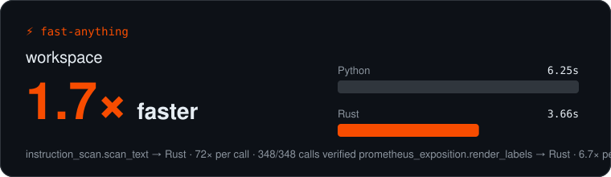

# ⚡ workspace: 1.7× faster

`python3 -m workload --minutes 240 --pw-fixed` went from **6.25s** to **3.66s** (median of 5 runs each, original and Rust interleaved).

| function | per call | checked against |
|---|---|---|
| `instruction_scan.scan_text` | **72×** (5.2ms → 71.8µs) | 348/348 recorded real calls |
| `prometheus_exposition.render_labels` | **6.7×** (3.5µs → 531ns) | 500/500 recorded real calls |
| `server.strip_ansi` | **7.1×** (176.2µs → 24.9µs) | 732/732 recorded real calls |

The original code stays in place: set `FAST_ANYTHING_DISABLE=1` to run it, or `fast-anything disable <id>` to remove the switch.

Made with [fast-anything](https://github.com/EL4CTEO/fast-anything)
